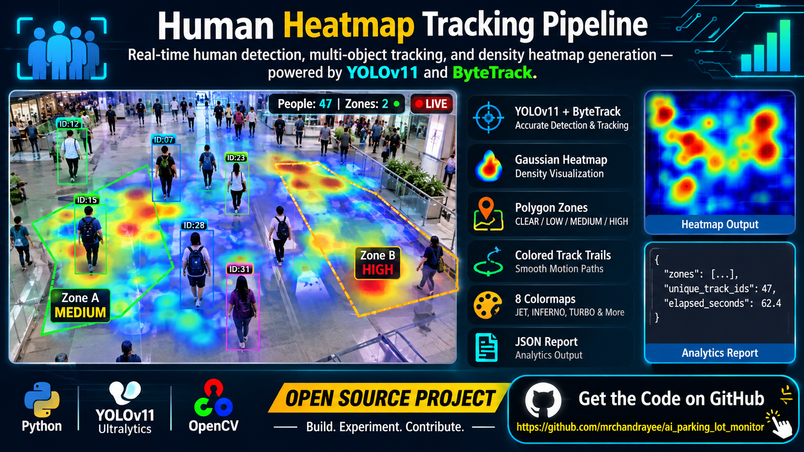

# Human Heatmap Tracking Pipeline

> Real-time human detection, multi-object tracking, and density heatmap generation — powered by YOLOv11 and ByteTrack.



---

## Overview

This pipeline processes live camera feeds or pre-recorded video to detect and track people, accumulate a Gaussian-weighted density heatmap, and classify configurable polygon zones by occupancy level. Every run produces an annotated output video, a standalone heatmap image, and a structured JSON analytics report.

The system is built on [Ultralytics YOLO](https://github.com/ultralytics/ultralytics) for detection and ByteTrack for stable multi-object tracking. Zone configuration is fully data-driven — no code changes needed to adapt the pipeline to a new floor plan or camera layout.

---

## Key Features

- **YOLOv11 + ByteTrack** — accurate person detection with persistent, low-drift track IDs across frames
- **Gaussian density heatmap** — per-frame heat accumulation with configurable radius, alpha blend, and temporal decay
- **Polygon zone analytics** — define any number of zones in `config/zones.json`; each zone reports live person count and density level (CLEAR / LOW / MEDIUM / HIGH)
- **Colored track trails** — per-ID motion trails with corner-style bounding boxes for clean visualization
- **8 colormaps** — JET, INFERNO, TURBO, HOT, PLASMA, MAGMA, VIRIDIS, RAINBOW
- **Structured JSON report** — frame-by-frame zone history, unique track count, and elapsed time saved alongside the output video
- **Zero-config defaults** — works out of the box with a webcam and the bundled `zones.json`

---

## Project Structure

```
human_heatmap_tracking_project/
├── human_heatmap_pipeline.py   # Main pipeline — detection, tracking, heatmap, zones
├── config/
│   └── zones.json              # Polygon zone definitions (normalized 0–1 coordinates)
├── output/                     # Generated artifacts (video, heatmap image, report)
├── requirements.txt
└── README.md
```

---

## Requirements

- Python 3.9+
- A CUDA-capable GPU is recommended for real-time performance; CPU inference works for offline video.

Install dependencies:

```bash
pip install -r requirements.txt
```

`requirements.txt` pins:

| Package | Version |
|---|---|
| ultralytics | ≥ 8.3.0 |
| opencv-python | ≥ 4.8.0 |
| numpy | ≥ 1.24.0 |

---

## Quick Start

**Run on webcam (default):**

```bash
python human_heatmap_pipeline.py
```

**Run on a video file:**

```bash
python human_heatmap_pipeline.py --source path/to/video.mp4
```

**Run with live display window:**

```bash
python human_heatmap_pipeline.py --source path/to/video.mp4 --display
```

Press `q` in the display window to stop early.

---

## All CLI Arguments

| Argument | Default | Description |
|---|---|---|
| `--source` | `0` | Camera index or path to video file |
| `--model` | `yolo11n.pt` | Ultralytics YOLO weights file |
| `--output` | `output/human_heatmap_tracking.mp4` | Output video path |
| `--zones` | `config/zones.json` | Polygon zone config file |
| `--conf` | `0.35` | Detection confidence threshold |
| `--iou` | `0.50` | NMS IoU threshold |
| `--imgsz` | `640` | Inference image size |
| `--radius` | `28` | Gaussian kernel radius for heatmap |
| `--alpha` | `0.42` | Heatmap blend opacity (0–1) |
| `--decay` | `0.995` | Heat decay multiplier per frame |
| `--decay-interval` | `1` | Apply decay every N frames |
| `--tail-len` | `30` | Track trail length in frames |
| `--frame-skip` | `1` | Process every Nth frame (1 = all) |
| `--report-interval` | `25` | Save zone snapshot every N frames |
| `--colormap` | `JET` | Heatmap colormap (see list below) |
| `--display` | off | Show live OpenCV window |

**Available colormaps:** `JET` · `INFERNO` · `TURBO` · `HOT` · `PLASMA` · `MAGMA` · `VIRIDIS` · `RAINBOW`

---

## Zone Configuration

Zones are defined in `config/zones.json` using normalized `[x, y]` coordinates (values between 0 and 1, relative to frame dimensions). This makes the config resolution-independent.

```json
{
  "zones": [
    {
      "name": "Line 1",
      "color": [0, 255, 0],
      "points": [
        [0.05, 0.18],
        [0.42, 0.18],
        [0.42, 0.92],
        [0.05, 0.92]
      ]
    }
  ]
}
```

Each zone can have any polygon shape. Add as many zones as needed. Color is `[B, G, R]` in OpenCV convention.

**Density thresholds (mean heat value within zone):**

| Level | Threshold | Overlay Color |
|---|---|---|
| CLEAR | < 0.1 | Green |
| LOW | 0.1 – 1.0 | Yellow |
| MEDIUM | 1.0 – 5.0 | Orange |
| HIGH | > 5.0 | Red |

---

## Output Artifacts

Each run saves three files (named after `--output`):

| File | Description |
|---|---|
| `human_heatmap_tracking.mp4` | Annotated video with heatmap overlay, bounding boxes, trails, and zone labels |
| `human_heatmap_tracking_heatmap.png` | Full accumulated heatmap image at the end of the run |
| `human_heatmap_tracking_report.json` | Per-interval zone snapshots, unique track count, total frames, elapsed time |

**Sample report structure:**

```json
{
  "source": "video.mp4",
  "frames_processed": 1500,
  "unique_track_ids": 47,
  "elapsed_seconds": 62.4,
  "zones": [ ... ],
  "zone_history": [
    {
      "frame": 25,
      "time_sec": 1.0,
      "zones": [
        { "name": "Line 1", "persons": 3, "density_mean": 2.14, "level": "MEDIUM" }
      ]
    }
  ]
}
```

---

## Example Usage

**High-confidence detection with TURBO colormap:**

```bash
python human_heatmap_pipeline.py \
  --source recording.mp4 \
  --conf 0.5 \
  --colormap TURBO \
  --alpha 0.55 \
  --display
```

**Faster processing on long videos (skip every other frame):**

```bash
python human_heatmap_pipeline.py \
  --source long_recording.mp4 \
  --frame-skip 2 \
  --output output/fast_run.mp4
```

**Custom YOLO model:**

```bash
python human_heatmap_pipeline.py \
  --source 0 \
  --model yolo11m.pt \
  --imgsz 1280
```

---

## How It Works

1. **Detection** — Each frame is passed through a YOLOv11 model filtered to `class=0` (person).
2. **Tracking** — ByteTrack assigns persistent integer IDs across frames. Bounding box centers are computed per track.
3. **Heatmap accumulation** — A 2D Gaussian kernel is stamped at each person's foot-center position into a float32 accumulator. A configurable decay factor prevents old hotspots from dominating.
4. **Zone evaluation** — For each polygon zone, the pipeline samples the accumulated heat within the mask, counts persons whose centers fall inside, and assigns a density level.
5. **Rendering** — The accumulator is percentile-normalized (99.5th percentile as max) and colorized, then alpha-blended onto the original frame. Zone overlays, track trails, and bounding boxes are composited on top.
6. **Output** — The annotated frame is written to the output video; zone snapshots are logged at the configured interval.

---

## Contributing

Contributions are welcome. To propose a change:

1. Fork the repository
2. Create a branch: `git checkout -b feature/your-feature`
3. Make your changes and verify they run cleanly
4. Open a pull request with a short description of what changed and why

Please keep the zone config format backward-compatible and avoid adding hard dependencies beyond the three in `requirements.txt` without discussion.

---

## License

This project is released under the [MIT License](LICENSE).

---

## Acknowledgements

- [Ultralytics](https://github.com/ultralytics/ultralytics) for the YOLO model family and ByteTrack integration
- [OpenCV](https://opencv.org/) for video I/O and rendering primitives
